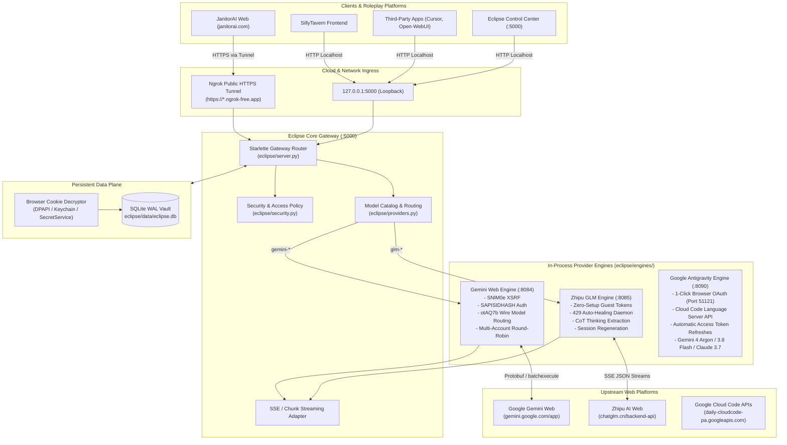
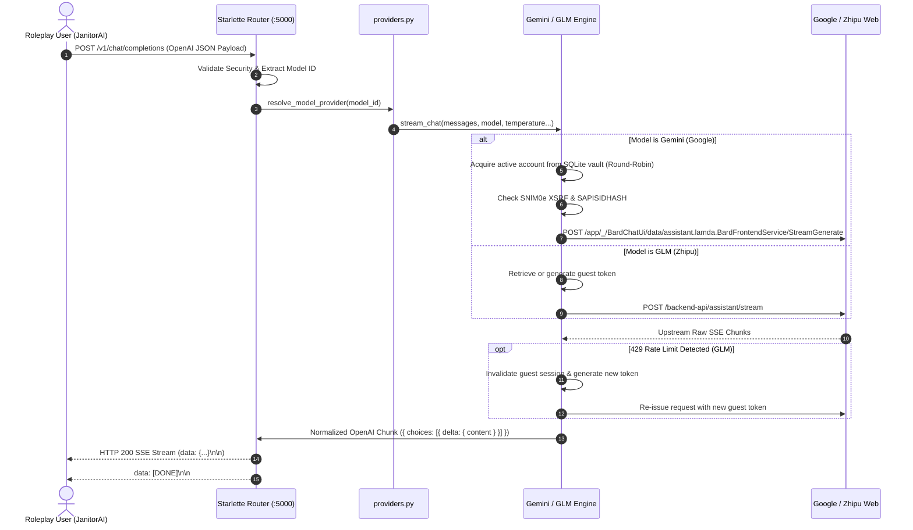

# 🌌 Eclipse Technical Architecture Guide
> **The structural blueprint and technical manual for Eclipse: Public Gemini Web & Zhipu GLM Reverse Proxy Gateway for Roleplay Platforms.**

---

## 📑 Table of Contents
1. [System Overview & Architecture Goals](#1-system-overview--architecture-goals)
2. [High-Level Architecture & Topology](#2-high-level-architecture--topology)
3. [Core Non-Negotiable Invariants](#3-core-non-negotiable-invariants)
4. [Repository Directory & File Anatomy](#4-repository-directory--file-anatomy)
5. [End-to-End Request & Streaming Pipeline](#5-end-to-end-request--streaming-pipeline)
6. [Provider Engines Deep-Dive (`eclipse/engines/`)](#6-provider-engines-deep-dive-eclipseengines)
   - [Google Gemini Web Engine (`gemini.py`)](#google-gemini-web-engine-geminipy)
   - [Zhipu GLM Engine & 429 Auto-Healer (`glm.py`)](#zhipu-glm-engine--429-auto-healer-glmpy)
7. [Credential Vault & Multi-Account Stacking (`eclipse/db.py`)](#7-credential-vault--multi-account-stacking-eclipsedbpy)
8. [Cloud Tunneling & Native Mobile Access (`eclipse/tunnel.py`)](#8-cloud-tunneling--native-mobile-access-eclipsetunnelpy)
9. [Web Control Center & Frontend Architecture (`eclipse/static/`)](#9-web-control-center--frontend-architecture-eclipsestatic)
10. [JanitorAI Companion Userscript (`userscripts/`)](#10-janitorai-companion-userscript-userscripts)
11. [Unified CLI Reference (`./start.sh` / `start.bat`)](#11-unified-cli-reference-startsh--startbat)

---

## 1. System Overview & Architecture Goals

**Eclipse** is a high-performance, self-contained AI reverse-proxy gateway designed specifically to serve the roleplay community (JanitorAI, SillyTavern, and open-source frontends). It converts authenticated web sessions and guest endpoints of frontier AI systems into a single standardized **OpenAI-compatible REST and SSE streaming API** hosted locally at `http://127.0.0.1:5000/v1`.

### Key Design Pillars:
- **Zero Financial Cost ($0.00)**: Eliminates API key paywalls by authentically driving upstream web backends.
- **Pure-Python Mobile-Friendly Architecture**: Runs natively on Android (Termux), Windows, macOS, and Linux without requiring Rust/Cargo or C compilation toolchains.
- **Zero-Setup Guest Inferences**: Zhipu GLM operates straight out of the box in guest mode with zero manual credential requirements.
- **Self-Healing Resilience**: Built-in 429 rate-limit auto-healers intercept upstream congestion and cycle tokens transparently without failing user chats.
- **1-Click Local Cookie Extraction**: Directly decrypts and imports browser sessions (Chrome, Brave, Edge, Firefox) into an encrypted SQLite WAL vault.

---

## 2. High-Level Architecture & Topology



---

## 3. Core Non-Negotiable Invariants

1. **Port 5000 Invariant**: Eclipse listens strictly on port `5000` (`http://localhost:5000/v1`). It must never clash with other applications or hardcode port 9000.
2. **Zero Rust Toolchain on Mobile**: `requirements.txt` is strictly restricted to pure-Python packages (`starlette`, `uvicorn`, `httpx`, `websockets`, `curl_cffi`). Never introduce `pydantic` or `fastapi` which trigger `cargo` compilation failures on Android Termux.
3. **Strict One-File Engine Modularity**: Each upstream provider is strictly encapsulated within its own file inside `eclipse/engines/` (`gemini.py`, `glm.py`). Auxiliary shell scripts or extraneous files are forbidden.
4. **Transparent 429 Auto-Healing**: If an upstream provider returns HTTP 429 or rate-limit warnings, the engine must handle re-tokenization, session refreshing, and retry logic internally before returning any payload to the client.
5. **Decoupled Standalone Workspace**: Eclipse is a fully independent public distribution. It never imports, links to, or executes files from private parent projects.

---

## 4. Repository Directory & File Anatomy

```
Eclipse/
├── eclipse/                   # Core Python package & runtime
│   ├── engines/              # Upstream provider reverse-proxy engines
│   │   ├── gemini.py         # Google Gemini Web wire engine (otAQ7b hashes, ALR stream)
│   │   ├── glm.py            # Zhipu GLM engine (guest token generator, 429 auto-healer)
│   │   └── __init__.py       # Engine registry & lazy exports
│   ├── static/               # Control center & Playground UI (vanilla ES6+)
│   │   ├── index.html        # Single-page interface
│   │   ├── style.css         # Modern dark glassmorphic styling
│   │   ├── app.js            # Frontend orchestration, playground, vault management
│   │   ├── preloader.js      # Robust preloader with 2.5s auto-dismiss safety
│   │   └── icons/            # Monochrome provider vector icons
│   ├── data/                 # Local data directory (auto-created)
│   │   └── eclipse.db        # Encrypted SQLite WAL credential vault
│   ├── db.py                 # SQLite database operations & cookie parsing
│   ├── providers.py          # Unified model catalog & engine dispatcher
│   ├── server.py             # Starlette ASGI gateway server (:5000)
│   ├── tunnel.py             # Native Ngrok binary manager & HTTPS tunnel
│   ├── security.py           # Access policies & local loopback verification
│   └── cli.py                # Command-line interface logic
├── userscripts/              # Companion browser scripts for roleplay
│   ├── eclipse-regex.user.js # JanitorAI DOM reply formatter & thought collapser
│   └── janitorai-probe.user.js # Non-intrusive DOM inspector for JanitorAI
├── start.sh                  # Canonical Unix / macOS / Termux startup script
├── start.bat                 # Windows native launcher with auto-updater
├── start.command             # macOS double-click wrapper
├── requirements.txt          # Pure-Python runtime dependencies
├── README.md                 # User-facing roleplay documentation
├── ORACLE_VPS_SETUP_GUIDE.md # 24/7 Free cloud hosting deployment guide
├── ARCHITECTURE.md           # This technical manual
└── MISTAKES.md               # Engineering lessons & post-mortem invariants
```

---

## 5. End-to-End Request & Streaming Pipeline

When JanitorAI (or SillyTavern) sends a chat completion request:



---

## 6. Provider Engines Deep-Dive (`eclipse/engines/`)

### Google Gemini Web Engine (`gemini.py`)
- **Authentication**: Uses `__Secure-1PSID` and `__Secure-1PSIDTS` session cookies. Generates `Authorization: SAPISIDHASH <timestamp>_<sha1>` derived from `SAPISID` and client origin (`https://gemini.google.com`).
- **Session Handshake**: Extracts `SNlM0e` XSRF token and `bl` build identifier directly from `https://gemini.google.com/app`.
- **Wire Model Routing**: Employs verified `otAQ7b` wire model hashes:
  - `gemini-4-argon`: Mode Hash `95a4c0abcba24364` (Mode 8)
  - `gemini-3.1-pro`: Mode Hash `e6fa609c3fa255c0` (Mode 3)
  - `gemini-3.8-flash`: Mode Hash `56fdd199312815e2` (Mode 1)
  - `gemini-3.5-flash-lite`: Mode Hash `8c46e95b1a07cecc` (Mode 6)
- **ALR Stream Demuxer**: Decodes Google's multiplexed chunk format (`)]}'`, length-prefixed JSON envelopes), extracts generated text fragments, and normalizes them into standard OpenAI deltas.
- **Multi-Account Round-Robin**: Automatically rotates accounts on quota exhaustion to maximize uptime.

### Zhipu GLM Engine & 429 Auto-Healer (`glm.py`)
- **Zero-Setup Guest Ingestion**: Requests guest device sessions from Zhipu Web when no account is supplied in the vault.
- **Model Support**:
  - `glm-5-turbo` & `glm-5-turbo-think`: Next-gen flagship with chain-of-thought analysis.
  - `glm-4.7` & `glm-4.7-think`: High-reasoning multilingual model.
  - `glm-4-plus` & `glm-4-flash`: Lightweight low-latency variants.
- **The 429 Rate-Limit Auto-Healer**:
  - Monitors incoming SSE streams for HTTP 429 status codes, `rate_limit_exceeded`, or `"err_code": 1301` payloads.
  - Transparently calls session invalidation, provisions a fresh guest identity in memory, and immediately re-executes the pending completion.
  - Completely shields JanitorAI from red error banners during high-traffic community usage.
- **Chain-of-Thought (CoT) Extraction**: Captures `<thought>` reasoning blocks and options metadata cleanly, passing formatted output to the frontend.

### Google Antigravity Engine & Official OAuth (`antigravity.py`)
- **Official Google OAuth 2.0**: Implements native browser OAuth consent flow on port `51121` (`http://localhost:51121/oauth-callback`).
- **Zero-Cookie Management**: Replaces fragile session cookie extraction with permanent OAuth refresh tokens that automatically generate fresh access tokens (`ya29...`) in the background.
- **Model Support**:
  - `gemini-4-argon` / `gemini-4-argon-high`: Google DeepMind Gemini 4 flagship reasoning.
  - `gemini-3.8-flash`: Rapid tiered low-latency reasoning model.
  - `gemini-2.5-pro`: Deep 2M token frontier reasoning.
  - `claude-opus-5-5` & `claude-sonnet-5-5` / `4-6`: Cloud Code reasoning Claude variants.
- **Automatic Fallback Routing**: If a user configured JanitorAI with `gemini-4-argon` and has no Web Gemini cookies in their vault, Eclipse seamlessly routes to their connected Google OAuth account so chat never breaks.

---

## 7. Credential Vault & Multi-Account Stacking (`eclipse/db.py`)

- **Storage Engine**: SQLite in Write-Ahead Logging (`PRAGMA journal_mode=WAL;`) mode, located at `eclipse/data/eclipse.db`.
- **Encryption**: Sensitive session tokens and cookies are encrypted at rest using OS-native keychains or a machine-derived key via `eclipse/security.py`.
- **1-Click Browser Auto-Discovery**:
  - Scans local browser profile directories:
    - **Google Chrome**: `~/.config/google-chrome`, `%LOCALAPPDATA%\Google\Chrome`
    - **Brave**: `~/.config/BraveSoftware`, `%LOCALAPPDATA%\BraveSoftware`
    - **Microsoft Edge**: `%LOCALAPPDATA%\Microsoft\Edge`
    - **Mozilla Firefox**: `cookies.sqlite` profiles
  - Extracts and decrypts cookies using Windows DPAPI, Linux Secret Service (`peanuts`), or macOS Keychain.
  - Validates tokens upstream with Google before storing to ensure zero dead accounts in the pool.
- **cURL Header Defense**: Intelligent parser detects pasted raw cURL commands and isolates solely the `Cookie:` header, rejecting spurious `-H` flags.

---

## 8. Cloud Tunneling & Native Mobile Access (`eclipse/tunnel.py`)

Because `janitorai.com` is served over HTTPS, modern mobile browsers (Safari on iOS, Chrome on Android) enforce Mixed Content Security and refuse to send AJAX requests to non-secure HTTP addresses (`http://localhost` or `http://192.168.x.x`).

Eclipse resolves this via native, automated Ngrok integration:
- **Zero-Install Binary Management**: Detects operating system and architecture (`x86_64`, `aarch64`, `armhf`).
- **Termux Architecture Detection**: Accurately queries `dpkg --print-architecture` to prevent ELF 64-bit vs 32-bit `Exec format error` crashes on Android.
- **Public Tunnel Generation**: Spins up an ephemeral or authenticated `https://*.ngrok-free.app` tunnel forwarding directly to port 5000.
- **Janitor-Ready URL**: Outputs the exact URL ready to be pasted into JanitorAI (`https://<id>.ngrok-free.app/v1/chat/completions`).

---

## 9. Web Control Center & Frontend Architecture (`eclipse/static/`)

The web interface accessible at `http://localhost:5000` is built on a **zero-build, pure vanilla ES6+ stack**:
- **Design Tokens (`style.css`)**: Dark glassmorphic aesthetic adhering strictly to the Warm Stone & Terracotta standard.
- **Interactive Playground**: Test Gemini and GLM models with live token counters, model pickers, and reasoning previews before configuring JanitorAI.
- **Account Vault Manager**: Add, delete, inspect quotas, and trigger 1-click browser auto-fetch.
- **Preloader Watchdog (`preloader.js`)**: Guaranteed safety timeout (2.5s) preventing preloader lockup on slow network connections or stalled assets.

---

## 10. JanitorAI Companion Userscript (`userscripts/`)

Located in `userscripts/eclipse-regex.user.js`:
- **Tampermonkey / Violentmonkey Compatible**: Runs seamlessly in the browser alongside JanitorAI.
- **DOM Regex Restyler**: Intercepts roleplay messages and dynamically restyles:
  - `<thought>...</thought>` blocks into clean, collapsible frosted-glass reasoning disclosures.
  - Tucao tags (`<tucao>`) and options lists (`<options>`) into selectable interactive action chips.
  - Character quotes into styled dialogue typography.
- **Privacy Assurance**: Operates 100% locally. Never transmits chat text to external servers.

---

## 11. Unified CLI Reference (`./start.sh` / `start.bat`)

All operations can be managed directly via the unified launcher:

| Command | Action |
| :--- | :--- |
| `./start.sh` (or `start.bat`) | Launch the Eclipse gateway server and open the web dashboard |
| `./start.sh status` | Inspect gateway health, active providers, and account counts |
| `./start.sh limits` | Query real-time upstream quotas and remaining requests |
| `./start.sh accounts` | List all accounts stored in the SQLite vault |
| `./start.sh autofetch gemini` | Trigger 1-click browser cookie discovery from terminal |
| `./start.sh chat "Prompt" -m <id>` | Perform live terminal streaming inference against any model |
| `./start.sh tunnel start` | Launch the public HTTPS Ngrok tunnel for mobile JanitorAI |
| `./start.sh tunnel stop` | Stop the active Ngrok tunnel |
| `./start.sh restart` | Cleanly reclaim port 5000 and restart the gateway daemon |
